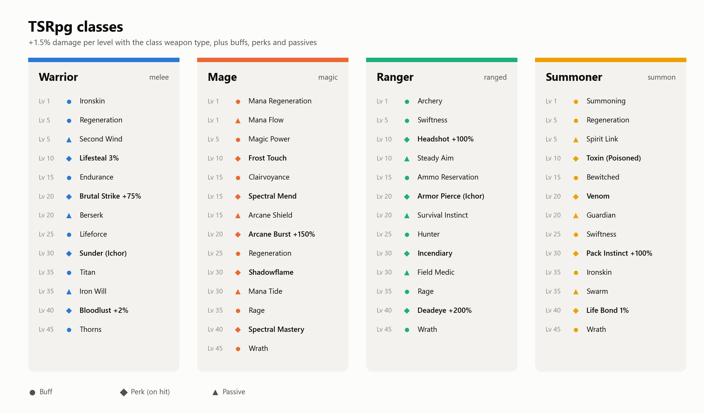
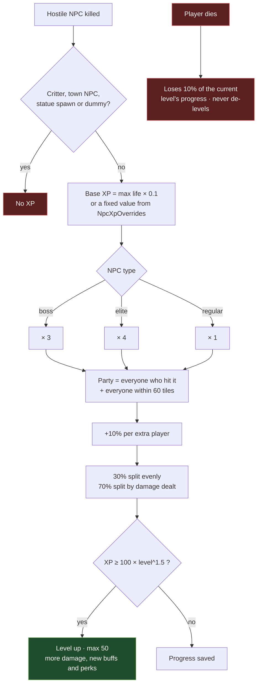
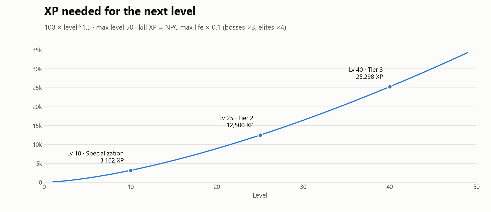
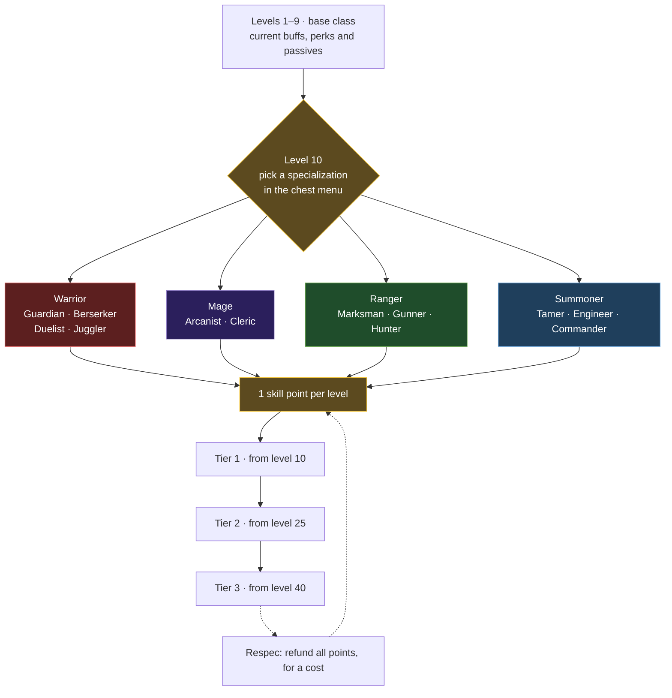

<h1 align="center">TSRpg</h1>

<strong>RPG classes, XP and levels for TShock servers, with mobs and bosses that grow with the players.</strong>

  
  
  
  

---

## Overview

TSRpg adds a light RPG layer on top of vanilla Terraria. It works with the unmodified game client: everything is done server-side.

- **XP and levels.** Killing hostile mobs gives XP based on their max life. Bosses give much more. Critters, town NPCs, statue spawns and target dummies give nothing.
- **Four classes.** Warrior, Mage, Ranger and Summoner. Each one gets permanent buffs, a damage bonus that grows with level for its own weapon type, and on-hit perks.
- **Group play pays off.** Kill XP is shared among everyone who hit the NPC and everyone close to it, with a bonus for each extra player.
- **Scaling difficulty.** New mobs get tougher with the level of the players around them, and bosses with the average level of everyone online. Some mobs spawn as **elites**: they glitter gold, hit harder, and give more XP and coins.

## Installation

1. Download `TSRpg.dll` from the [Releases page](https://github.com/matheus-fsc/TS_Rpg/releases).
2. Place it into your TShock `ServerPlugins` folder.
3. Restart the server. On first launch the plugin creates `tshock/TSRpg/` containing the config, the translation files and the SQLite database.

## Commands

| Command | Permission | Description |
| --- | --- | --- |
| `/class [name]` (`/classe`) | none | Lists the classes or picks one. The first pick is free; switching again has a cooldown. |
| `/rpg` (`/nivel`, `/level`) | none | Shows your level, XP, damage bonus, active buffs and perks, and the next unlock. |
| `/menu` (`/rpgmenu`) | none | Opens the class menu in a chest window. Needs server side characters (SSC). |
| `/rpgtop` | none | Highest level players. |
| `/rpgadmin <setlevel\|givexp\|setclass\|reset> <player> [value]` | `tsrpg.admin` | Admin tools. |
| `/rpgreload` | `tsrpg.admin` | Reloads the config and translations. |

## Classes

All classes gain **+1.5% damage per level** (up to +73.5% at level 50) on hits with their own weapon type. Summoners also get it while they have a minion or sentry out.

<picture>
  <source media="(prefers-color-scheme: dark)" srcset="docs/images/classes-dark.png">
  
</picture>

| Level | Warrior (melee) | Mage (magic) | Ranger (ranged) | Summoner (summon) |
| --- | --- | --- | --- | --- |
| 1 | Ironskin | Mana Regeneration | Archery | Summoning |
| 5 | Regeneration | Magic Power | Swiftness | Regeneration |
| 10 | *Lifesteal* 3% | *Frost Touch* (Frostburn) | *Headshot* +100% | *Toxin* (Poisoned) |
| 15 | Endurance | Clairvoyance, *Spectral Mend* (team heal) | Ammo Reservation | Bewitched |
| 20 | *Brutal Strike* +75% | *Arcane Burst* +150% | *Armor Pierce* (Ichor) | *Venom* |
| 25 | Lifeforce | Regeneration | Hunter | Swiftness |
| 30 | *Sunder* (Ichor) | *Shadowflame* | *Incendiary* (Cursed Inferno) | *Pack Instinct* +100% |
| 35 | Titan | Rage | Rage | Ironskin |
| 40 | *Bloodlust* +2% lifesteal | *Spectral Mastery* (more team heal) | *Deadeye* +200% | *Life Bond* 1% lifesteal |
| 45 | Thorns | Wrath | Wrath | Wrath |

Each class also unlocks **perks** (effects that trigger on hit) and **passives** (always on):

```mermaid
flowchart LR
    subgraph W["Warrior · melee"]
        direction TB
        W5{{"Lv 5 · Second Wind<br/>regen in combat"}} --> W10(["Lv 10 · Lifesteal 3%"])
        W10 --> W20(["Lv 20 · Brutal Strike +75%"])
        W20 --> W20b{{"Lv 20 · Berserk<br/>below 30% life"}}
        W20b --> W30(["Lv 30 · Sunder · Ichor"])
        W30 --> W35{{"Lv 35 · Iron Will<br/>more regen"}}
        W35 --> W40(["Lv 40 · Bloodlust +2%"])
    end
    subgraph M["Mage · magic"]
        direction TB
        M1{{"Lv 1 · Mana Flow<br/>mana on hit"}} --> M10(["Lv 10 · Frost Touch"])
        M10 --> M15(["Lv 15 · Spectral Mend<br/>team heal"])
        M15 --> M15b{{"Lv 15 · Arcane Shield<br/>below 30% life"}}
        M15b --> M20(["Lv 20 · Arcane Burst +150%"])
        M20 --> M30(["Lv 30 · Shadowflame"])
        M30 --> M30b{{"Lv 30 · Mana Tide"}}
        M30b --> M40(["Lv 40 · Spectral Mastery"])
    end
    subgraph R["Ranger · ranged"]
        direction TB
        R10(["Lv 10 · Headshot +100%"]) --> R10b{{"Lv 10 · Steady Aim<br/>standing still"}}
        R10b --> R20(["Lv 20 · Armor Pierce · Ichor"])
        R20 --> R20b{{"Lv 20 · Survival Instinct<br/>below 30% life"}}
        R20b --> R30(["Lv 30 · Incendiary"])
        R30 --> R30b{{"Lv 30 · Field Medic<br/>regen out of combat"}}
        R30b --> R40(["Lv 40 · Deadeye +200%"])
    end
    subgraph S["Summoner · summon"]
        direction TB
        S5{{"Lv 5 · Spirit Link<br/>regen per minion"}} --> S10(["Lv 10 · Toxin · Poisoned"])
        S10 --> S20(["Lv 20 · Venom"])
        S20 --> S20b{{"Lv 20 · Guardian<br/>below 30% life"}}
        S20b --> S30(["Lv 30 · Pack Instinct +100%"])
        S30 --> S35{{"Lv 35 · Swarm"}}
        S35 --> S40(["Lv 40 · Life Bond 1%"])
    end

    classDef warrior fill:#5c1f1f,stroke:#e06666,color:#fff
    classDef mage fill:#2b1f5c,stroke:#8e7cc3,color:#fff
    classDef ranger fill:#1f4d2b,stroke:#6aa84f,color:#fff
    classDef summoner fill:#1f3f5c,stroke:#6fa8dc,color:#fff
    class W5,W10,W20,W20b,W30,W35,W40 warrior
    class M1,M10,M15,M15b,M20,M30,M30b,M40 mage
    class R10,R10b,R20,R20b,R30,R30b,R40 ranger
    class S5,S10,S20,S20b,S30,S35,S40 summoner
```

Rounded boxes are perks, hexagons are passives. *Italic* entries in the table are perks. The mage's heals go to the most hurt player nearby (the mage included), like the Spectre hood. Buffs, perks, chances and values can all be changed in the config.

## XP and levels

<picture>
  <source media="(prefers-color-scheme: dark)" srcset="docs/images/xp-curve-dark.png">
  
</picture>

Mobs also grow tougher with the level of the players around them; see [Difficulty scaling](#difficulty-scaling).

## Class menu

`/menu` shows the classes and your unlocks in a vanilla chest window, so players can browse and pick a class without typing names.

- **Top row:** the four classes. Your current class shows your level as the stack number.
- **Below:** your class's buffs, perks and passives in level order. Locked ones show as gray bricks.
- **Clicking** an icon puts its name in the window title, with its icon and a color, and sends the full description to chat. Picking a class takes two clicks on the same icon, so a stray click never changes it.
- **The title** shows your class and level when the menu opens.

The menu needs **server side characters** (`tshock/sscconfig.json`, `"Enabled": true`). The server never creates a real chest: an invisible chest tile is sent to that player only, and is removed when the menu closes. Clicks are refused and the icons are sent back, so nothing can be taken out of the menu or put into it.

Items keep their vanilla names on hover. The vanilla client has no way for a server to rename an item, so the window title and the chat legend say what each icon is.

## Planned: specializations

At level 10 each class will pick a specialization tied to the weapon types it uses (for example, Guardian, Berserker, Duelist and Juggler for melee). Class bonuses are done by the server (extra hits, damage absorption, healing, max life and mana with SSC), never with potion buffs, so they always stack with the potions players drink. The design notes, in Portuguese, are in [docs/design-interface-especializacoes-lootchest.md](docs/design-interface-especializacoes-lootchest.md).

Each specialization gets full bonuses with its own weapon types and half with the rest, so nobody is stuck with a weak weapon early on.

## Difficulty scaling

Terraria computes enemy contact damage on the client, so changing an NPC's damage on the server has no effect. TSRpg uses the game's own per-NPC **difficulty** value instead, the same one Journey mode's difficulty slider uses (Classic 1, Expert 2, Master 3, Legendary 4). When an NPC spawns, the plugin raises that value before the NPC is first sent to clients. The client then builds the NPC with the same life and damage as the server, and health bars stay correct.

| Setting | Default | Effect |
| --- | --- | --- |
| `MobDifficultyPerLevel` | `0.015` | Mobs: +0.015 difficulty per level of the nearby players (Master → ~3.74 at level 50). |
| `BossDifficultyBonus` / `BossDifficultyPerLevel` | `0.25` / `0.015` | Bosses: flat bonus plus the average online level. |
| `MaxNpcDifficulty` | `4.0` | Cap for regular mobs and bosses. |
| `EliteChance` / `EliteDifficultyBonus` | `0.04` / `1.0` | Elites: 4% of mobs once players reach level 5; they always may reach 4.0. |

From Master (3) to Legendary (4) vanilla curves give enemies ×1.33 life and ×1.78 contact damage, and they drop more coins. Nothing grows past 4.

## Configuration

File: `tshock/TSRpg/RpgConfig.json`

| Key | Default | Description |
| --- | --- | --- |
| `Language` | `"en-US"` | Translation file from `tshock/TSRpg/Translations/` (`en-US` or `pt-BR` bundled). |
| `XpPerLifePoint` | `0.1` | XP per point of NPC max life. |
| `BossXpMultiplier` / `EliteXpMultiplier` | `3.0` / `4.0` | Extra XP for bosses and elites. |
| `NpcXpOverrides` | `{}` | Fixed XP per NPC id, e.g. `{ "4": 2000 }`. |
| `PartyRangeTiles` | `60` | Players this close to a kill take part in it. |
| `PartyBonusPerPlayer` | `0.1` | +10% kill XP per extra participant. |
| `PartyEvenShare` | `0.3` | 30% of kill XP is split evenly; the rest by damage dealt. |
| `XpLossOnDeathPercent` | `10` | Share of the current level's progress lost on death (never de-levels). |
| `LevelBaseXp` / `LevelExponent` / `MaxLevel` | `100` / `1.5` / `50` | XP to next level = 100 × level^1.5. |
| `ClassChangeCooldownMinutes` | `60` | Cooldown between class changes. |
| `Classes` | see above | Full class definitions: damage type, damage per level, buffs and perks. |
| `ExtraBossNpcIds` | boss parts | NPCs treated as bosses (hands, segments...). |

## License

[MIT](LICENSE)
